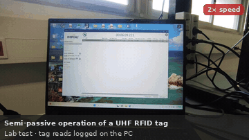
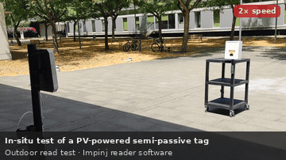
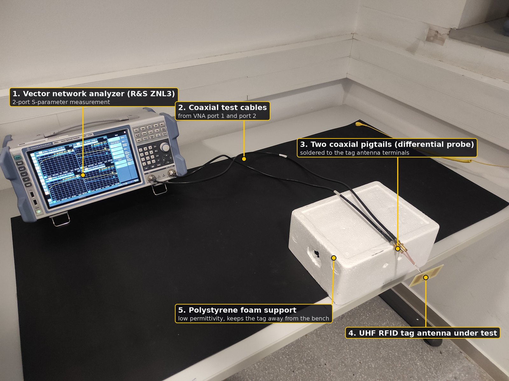
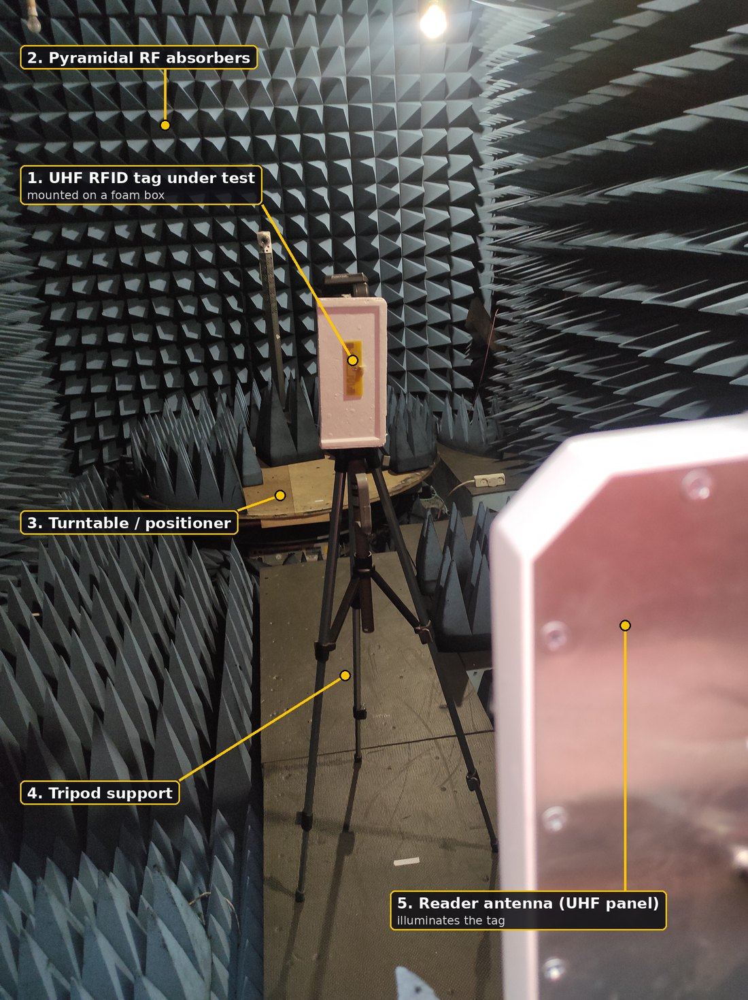
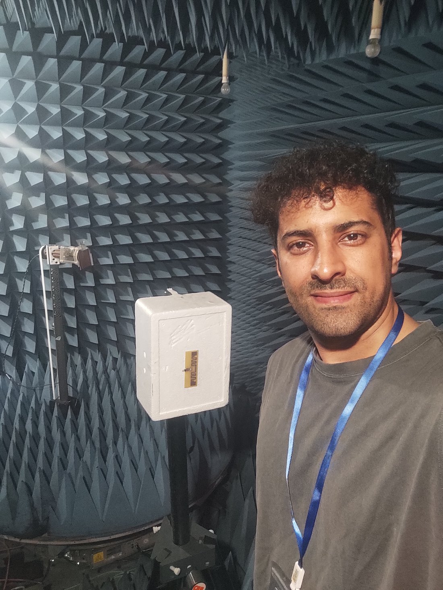

# RFID

UHF RFID tag design and characterization in the European band (~866 MHz): passive and semi-passive tags, antenna–chip impedance matching, antenna impedance measurement with a VNA, anechoic-chamber characterization, and light-powered (PV) semi-passive tags that extend the read range. This repository collects demo videos and labeled photos of the measurement setups.

## Demo videos

<table>
<tr>
<td align="center" width="50%"><a href="Media/semi_passive_tag_operation.mp4"></a><br><b>Semi-passive operation of an RFID tag</b><br><sub>Lab test of a semi-passive UHF RFID tag: the tag chip is assisted by a DC supply, which boosts its sensitivity compared with passive mode, while the reads are logged on the PC (GIF at 2× speed).</sub><br><sub><a href="Media/semi_passive_tag_operation.mp4">▶ Full video with sound (MP4)</a></sub></td>
<td align="center" width="50%"><a href="Media/pv_semi_passive_tag_in_situ.mp4"></a><br><b>In-situ characterization of a PV-powered semi-passive tag</b><br><sub>Outdoor test of a battery-free semi-passive tag powered by a photovoltaic cell, placed at a distance from the reader antenna and read with Impinj reader software (GIF at 2× speed).</sub><br><sub><a href="Media/pv_semi_passive_tag_in_situ.mp4">▶ Full video with sound (MP4)</a></sub></td>
</tr>
</table>

## Gallery

### Antenna impedance measurement

<table>
<tr><td align="center"><a href="Media/rfid_antenna_impedance_vna_setup.jpg"></a><br><b>Measurement setup of the RFID antenna impedance using a VNA</b></td></tr>
</table>

The tag antenna is balanced, so its impedance is measured differentially: two coaxial pigtails are soldered to the antenna terminals (where the chip is placed) and connected to ports 1 and 2 of an R&S ZNL3 vector network analyzer. The differential impedance is calculated from the measured two-port S-parameters and compared with the chip impedance to evaluate the antenna–chip matching. A polystyrene foam box keeps the tag away from the bench so that it does not detune the antenna.

### Anechoic chamber characterization

<table>
<tr>
<td align="center" width="50%"><a href="Media/rfid_tag_anechoic_chamber_setup.jpg"></a><br><b>Tag measurement in the anechoic chamber</b></td>
<td align="center" width="50%"><a href="Media/anechoic_chamber_characterization_day.jpg"></a><br><b>The day of antenna performance characterization in the anechoic chamber</b></td>
</tr>
<tr>
<td valign="top">The tag is mounted on a foam box on a tripod in front of a UHF reader panel antenna. The pyramidal absorbers suppress reflections, so the tag's sensitivity (activation power), read range and radiation pattern can be measured as in free space.</td>
<td valign="top">Me in the anechoic chamber with the tag under test on the positioner, during the antenna performance characterization.</td>
</tr>
</table>

## Related publications

- "Design of Passive and Semi-Passive RFID Tags", IEEE RFID-TA 2025. [doi:10.1109/RFID-TA63091.2025.11265906](https://doi.org/10.1109/RFID-TA63091.2025.11265906)
- "Live Demonstration: a Battery-Free Light-Powered Semi-Passive Tag", IEEE SENSORS 2026.

## Folder structure

```
RFID/
└── Media/ (demo videos, GIFs and labeled measurement photos)
```

See also: [RF-Energy-Harvesting-Rectenna](https://github.com/fereshtianamir-lab/RF-Energy-Harvesting-Rectenna) – 868 MHz rectennas, [Wireless-Power-Transfer](https://github.com/fereshtianamir-lab/Wireless-Power-Transfer) – magnetic-resonance WPT coils, and [RF-Antenna](https://github.com/fereshtianamir-lab/RF-Antenna) – antenna and transmission-line models in HFSS, CST and FEKO.
